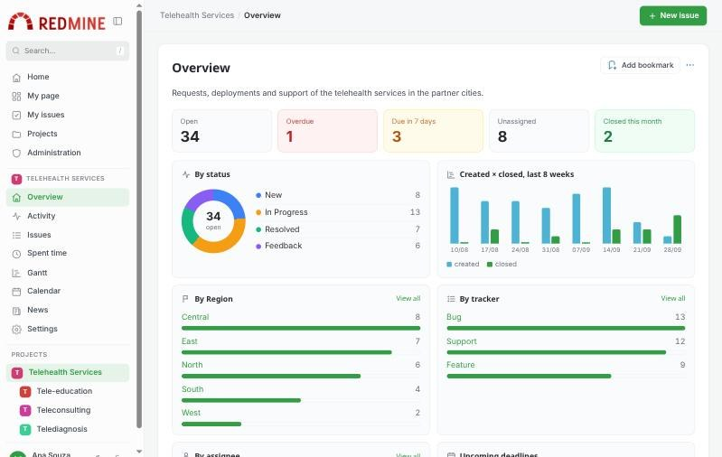
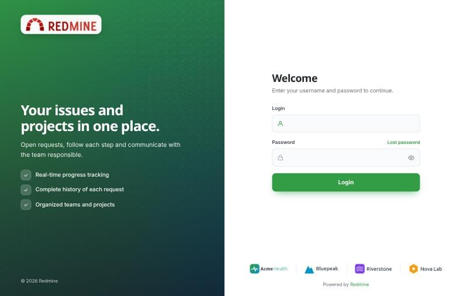
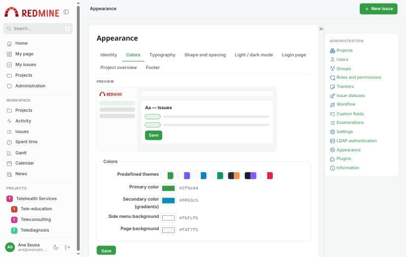
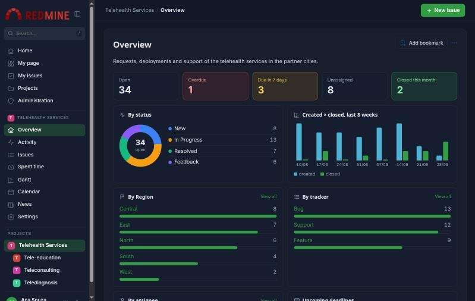

# Redmine Modern Layout

A modern, customizable layout for Redmine: side navigation, top bar, card-based content, login page styles,
a project overview dashboard and an **Appearance** page to set logo, colors, fonts, footer and dark mode
without editing code.

[Português (Brasil)](README.pt-BR.md)

## What's new

* 0.1.0: First release. See [CHANGELOG](CHANGELOG.md).

## Features

### Layout
* Collapsible **side navigation** with icons: home, my page, my issues, projects, administration, the project menu and the project tree.
* **Search box** in the menu (press `/` to focus it), **top bar** with breadcrumbs and a **New issue** button.
* Content in **cards**; status and priority shown as colored pills; responsive menu on small screens.
* **Light, dark or automatic** mode (follows the operating system), with an optional switch for each user.

### Appearance (Administration > Appearance)
Organized in tabs, with a live preview:
* **Identity**: system name, logo and browser tab icon (also used on the collapsed menu).
* **Colors**: 7 predefined themes or your own primary, secondary, menu and page colors.
* **Typography and shape**: 12 fonts (system font or Google Fonts), base text size, corner radius and density.
* **Login page**: 5 styles — *Split*, *Showcase*, *Card*, *Partner banner* and *Classic* — with title, subtitle,
  headline, supporting text, highlights, background image and partner banner. Icons in the fields and a show / hide password button.
* **Project overview**: dashboard on/off, the custom field of the distribution chart and the time tracking block.
* **Footer**: text, links, partner banner and "Powered by Redmine".

### Project overview dashboard
* Indicators — open, overdue, due in 7 days, unassigned, closed this month — each one opening the filtered issue list.
* Issues by status, created × closed over the last 8 weeks, by tracker, by a custom field of your choice
  (e.g. *Region*) and by assignee, with an "Others" row and a "View all" link.
* Upcoming deadlines, recent activity and **subprojects as cards** with progress.
* Numbers only include the issues each user is allowed to see.

### Other
* Uploaded images are checked by their content; SVG files with scripts are refused and images are served with a sandbox Content-Security-Policy.
* No database migrations, no gems, no external JavaScript libraries.
* Translated into 10 languages: English, Portuguese (Brazil), Portuguese (Portugal), Spanish, French, Italian, German, Russian, Japanese and Chinese (Simplified).
* Sample images to try it in [`docs/samples`](docs/samples) (official Redmine logo and fictional partners).

## Screenshots

### Login page (Split style)

### Administration > Appearance

### Dark mode

## Required Redmine version

* 6.0.x ~ 6.1.x

| Redmine | Rails | Ruby | Test |
|---|---|---|---|
| 6.0.5 | 7.2.2.1 | 3.3.8 | full test in the browser (MySQL) |
| 6.1.5 | 7.2.4 | 3.4.11 | pages, dashboard and login (SQLite); no JavaScript errors in the browser |

The plugin replaces the base layout (`layouts/base`) and the project overview (`projects/show`) of Redmine 6.
Plugins that replace the same views are not compatible. Use Redmine's default theme.

## Install

1. Move to the `plugins` folder of your Redmine.
<pre>
git clone --branch v0.1.0 https://github.com/cerqueirav/redmine_modern_layout.git
</pre>
2. Restart Redmine.
3. Go to **Administration > Appearance**.

## Uninstall

1. Remove the `plugins/redmine_modern_layout` folder.
2. Optional: remove the uploaded images in `files/modern_layout`.
3. Restart Redmine.

## Author

Victor Cerqueira — dev.cerqueirav@gmail.com

## License

GNU General Public License v3.0 or later. See [LICENSE](LICENSE).

`app/views/layouts/base.html.erb` and `app/views/projects/show.html.erb` are based on Redmine's views
(Copyright (C) Jean-Philippe Lang, GPL v2 or later). The sample logo in `docs/samples` is the Redmine logo by
Martin Herr (CC BY-SA 2.5).

If you modify and distribute this plugin, keep the copyright notices, state your changes and
distribute your version under the same license.
