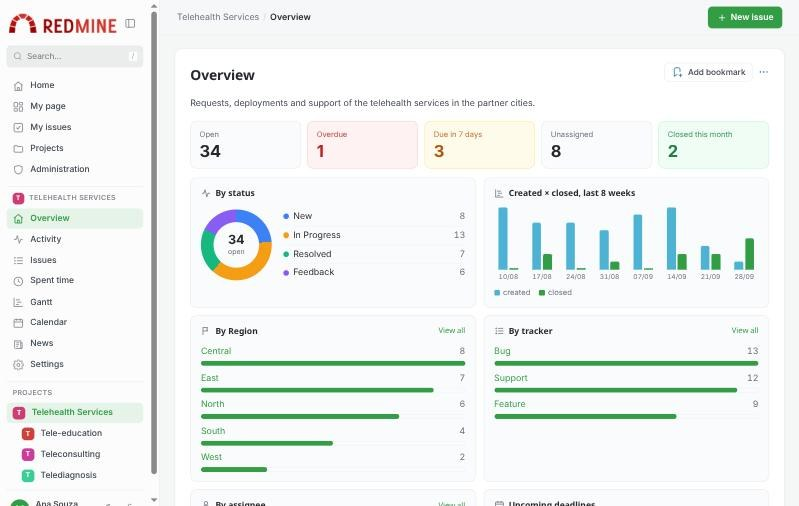
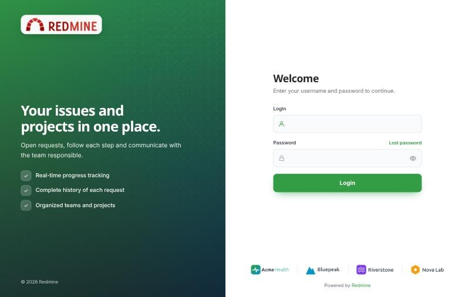
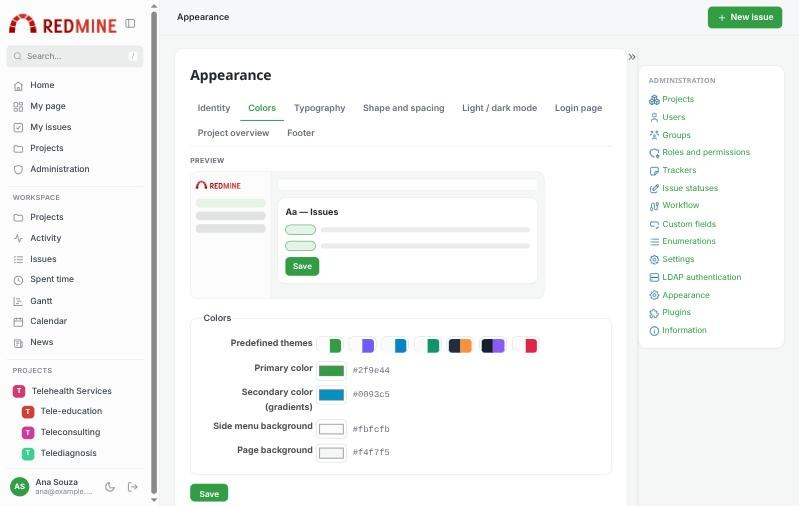
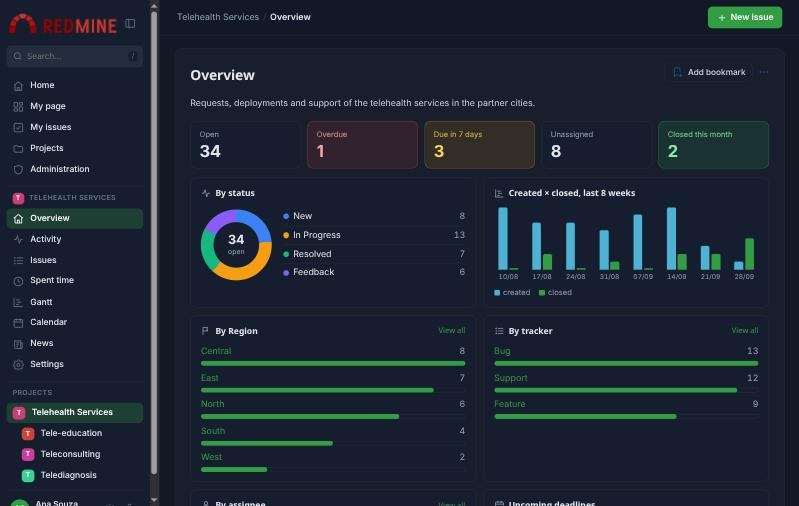

# Redmine Modern Layout

Um layout moderno e personalizável para o Redmine: navegação lateral, barra superior, conteúdo em cartões,
estilos de tela de login, painel na visão geral do projeto e uma página de **Aparência** para definir logotipo,
cores, fontes, rodapé e modo escuro sem editar código.

[English](README.md)

## Novidades

* 0.1.0: primeira versão. Veja o [CHANGELOG](CHANGELOG.md).

## Funcionalidades

### Layout
* **Navegação lateral** recolhível, com ícones: página inicial, minha página, minhas tarefas, projetos, administração, menu do projeto e árvore de projetos.
* **Busca** no menu (tecla `/`), **barra superior** com o caminho da página e o botão **Nova tarefa**.
* Conteúdo em **cartões**; situação e prioridade como etiquetas coloridas; menu adaptado para celular.
* Modo **claro, escuro ou automático** (segue o sistema operacional), com opção de cada usuário alternar.

### Aparência (Administração > Aparência)
Organizada em abas, com pré-visualização:
* **Identidade**: nome do sistema, logotipo e ícone da aba do navegador (também usado no menu recolhido).
* **Cores**: 7 temas predefinidos ou cores próprias (principal, secundária, menu e página).
* **Tipografia e forma**: 12 fontes (do sistema ou Google Fonts), tamanho do texto, arredondamento e densidade.
* **Tela de login**: 5 estilos — *Dividido*, *Vitrine*, *Cartão*, *Faixa de parceiros* e *Clássico* — com título, subtítulo,
  frase de destaque, texto de apoio, itens em destaque, imagem de fundo e faixa de parceiros. Ícones nos campos e botão mostrar / ocultar senha.
* **Visão geral do projeto**: painel ligado/desligado, campo personalizado do gráfico de distribuição e bloco de registro de horas.
* **Rodapé**: texto, links, faixa de parceiros e "Powered by Redmine".

### Painel da visão geral do projeto
* Indicadores — abertas, atrasadas, vencem em 7 dias, sem responsável, fechadas no mês — cada um abre a lista de tarefas filtrada.
* Tarefas por situação, criadas × fechadas nas últimas 8 semanas, por tipo, por um campo personalizado à escolha
  (ex.: *Macrorregião*) e por responsável, com a linha "Outros" e o link "Ver todos".
* Próximos prazos, atividade recente e **subprojetos em cartões** com progresso.
* Os números consideram apenas as tarefas que cada usuário pode ver.

### Outros
* As imagens enviadas são verificadas pelo conteúdo; SVG com scripts é recusado e as imagens são servidas com Content-Security-Policy restrita.
* Sem migrações de banco, sem gems e sem bibliotecas JavaScript externas.
* Traduzido para 10 idiomas: inglês, português (Brasil), português (Portugal), espanhol, francês, italiano, alemão, russo, japonês e chinês (simplificado).
* Imagens de exemplo em [`docs/samples`](docs/samples) (logotipo oficial do Redmine e parceiros fictícios).

## Capturas de tela

### Tela de login (estilo Dividido)

### Administração > Aparência

### Modo escuro

## Versão do Redmine necessária

* 6.0.x ~ 6.1.x

| Redmine | Rails | Ruby | Teste |
|---|---|---|---|
| 6.0.5 | 7.2.2.1 | 3.3.8 | teste completo no navegador (MySQL) |
| 6.1.5 | 7.2.4 | 3.4.11 | páginas, painel e login (SQLite); sem erros de JavaScript no navegador |

O plugin substitui o layout base (`layouts/base`) e a visão geral do projeto (`projects/show`) do Redmine 6.
Plugins que substituem as mesmas telas não são compatíveis. Use o tema padrão do Redmine.

## Instalação

1. Acesse a pasta `plugins` do seu Redmine.
<pre>
git clone --branch v0.1.0 https://github.com/cerqueirav/redmine_modern_layout.git
</pre>
2. Reinicie o Redmine.
3. Acesse **Administração > Aparência**.

## Desinstalação

1. Remova a pasta `plugins/redmine_modern_layout`.
2. Opcional: remova as imagens enviadas em `files/modern_layout`.
3. Reinicie o Redmine.

## Autor

Victor Cerqueira — dev.cerqueirav@gmail.com

## Licença

GNU General Public License v3.0 ou posterior. Veja o [LICENSE](LICENSE).

`app/views/layouts/base.html.erb` e `app/views/projects/show.html.erb` são baseados nas telas do Redmine
(Copyright (C) Jean-Philippe Lang, GPL v2 ou posterior). O logotipo de exemplo em `docs/samples` é o logotipo do Redmine,
de Martin Herr (CC BY-SA 2.5).

Se você modificar e distribuir este plugin, mantenha os avisos de direitos autorais, indique suas alterações e
distribua sua versão sob a mesma licença.
